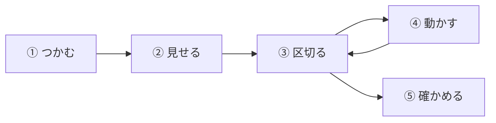
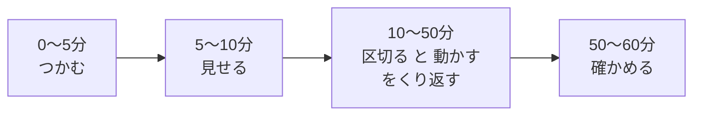
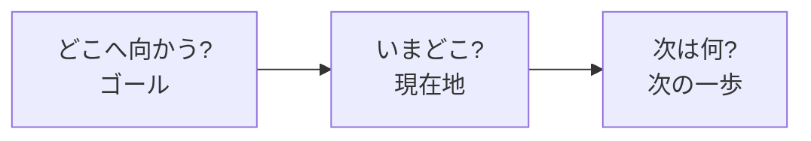
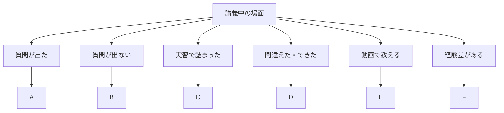
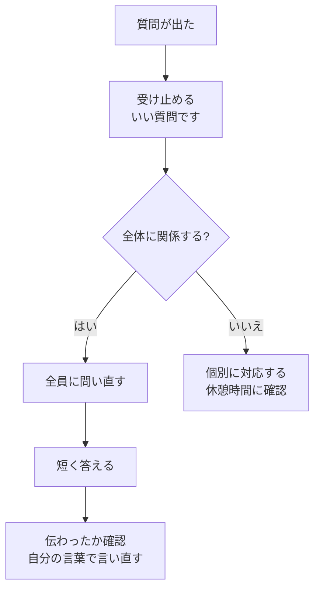
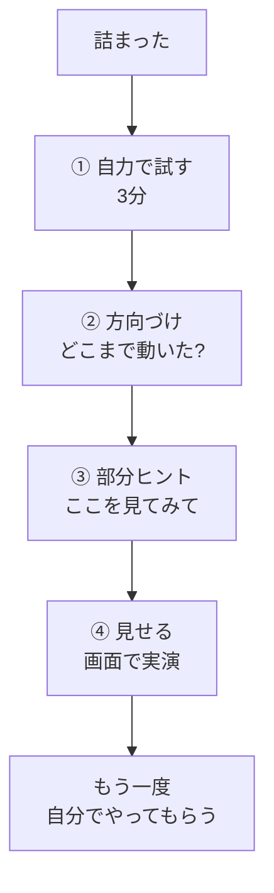
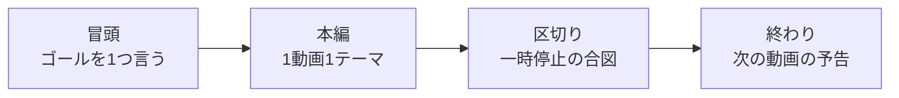

<!--
【Qiita投稿メモ】このコメントは削除してから投稿
タイトル: 【コピペOK】講義の進め方フレームワーク「5ステップ」とシーン別フレーズ集 ― 図解と査読済み論文で読み解く
タグ: 研修, 講義, 教育, 学習科学, 初心者
更新: 2026-10-01（図解の追加、シーン別フレーズの追加、参考論文の更新）
-->

「分かりましたか？」と聞いて、全員がうなずいた。なのに、実習になると手が止まる。
講義をしたことがある人なら、一度は経験があるのではないでしょうか。

原因は、話し方の上手い下手ではなく、**講義の「進め方」に型がないこと**かもしれません。この記事では、講義を5つのステップに分け、各ステップで**そのまま使えるフレーズ**を紹介します。さらに、「質問が出たとき」「実習で詰まったとき」など、**シーン別のフレーズ**も用意しました。どれも、根拠になる**査読済み論文**を示しています。

:::note info
**この版で更新した点**
- **図解**を5点追加しました（時間配分、質問対応、ヒント3段階、フィードバック、シーン対応）
- **シーン別フレーズ**を6場面追加しました（質問・沈黙・詰まったとき・間違い／称賛・動画講義・経験差）
- **参考論文**を7本追加しました（Wood ら、Bjork & Bjork、Mueller & Dweck、Edmondson、Guo ら、Kalyuga ら、Atkinson ら）
:::

## 全体像：講義は「5ステップ」で回す

| ステップ | やること | 主な根拠 |
|:--|:--|:--|
| ① つかむ | ゴールを伝え、前回の内容を思い出してもらう | Roediger & Karpicke (2006) |
| ② 見せる | 全体の地図を先に渡す | Meyer ら (1980)、Schneider ら (2018) |
| ③ 区切る | 意味のまとまりで小分けにする | Rey ら (2019) |
| ④ 動かす | 聞くだけにせず、考えさせる | Freeman ら (2014) |
| ⑤ 確かめる | 要点を思い出してもらい、次の一歩を示す | Hattie & Timperley (2007) |

60分の講義なら、次の配分が一つの目安です。

ただしこの配分は筆者の目安で、研究が示した数字ではありません。

:::note warn
**先に読んでほしい注意**
紹介する研究の多くは、大学の授業・学習教材・文章の読解・子どもの学習を対象にしています。企業研修やIT研修そのものを測った研究ではありません。「使い方」は、研究から筆者が導いた解釈です。
:::

## ① つかむ：ゴールを言い、前回を思い出してもらう

**使えるフレーズ**

- 「今日のゴールは『〇〇ができる』です」
- 「前回の内容を、何も見ずに1分で書き出してみましょう」
- 「終わるころには、この課題が解けるようになります」

**根拠**　Roediger & Karpicke (2006) の実験では、文章を学んだあとに**思い出すテスト**を受けた学生は、同じ文章を繰り返し読んだ学生より、**1週間後**の成績が高くなりました。一方、5分後のテストでは、繰り返し読んだほうが高い成績でした。

**やさしく言うと**　講義の冒頭で「思い出す時間」をつくると、前回の内容が長く残りやすくなります。読み返しより、書き出しです。

## ② 見せる：全体の地図を先に渡す

**使えるフレーズ**

- 「今日は3つの話をします。①〜 ②〜 ③〜」
- 「いま2つ目です。ここから手順の話に入ります」
- 「この3行だけ覚えて帰ってください」

**根拠**

- Meyer, Brandt & Bluth (1980) は、9年生を対象に、文章の**全体構造を手がかりに内容を思い出す**読者ほど、より多くを思い出せることを示しました
- Schneider ら (2018) は、**103件の研究（参加者12,201人）**のメタ分析で、教材の構造や重要点を示す手がかり（シグナリング）が、学習成績を高めることを報告しました

**やさしく言うと**　「今日はこの3つ」「いまここ」と言葉で道しるべを出すと、聞き手が迷子になりません。スライドの見出しや太字も、同じ働きをします。

## ③ 区切る：意味のまとまりで小分けにする

**使えるフレーズ**

- 「ここまでを一度まとめます」
- 「次に進む前に、ここまでで質問はありますか」
- 「ここは補足なので、実習には影響しません」

**根拠**　Rey ら (2019) は、**56件の研究（88の比較）**をまとめ、内容を意味のある単位に区切ると、保持と転移に**小〜中程度の効果**があり、認知的な負荷も下がることを報告しました。なお、事前知識が多い学習者のほうが、保持の面で恩恵が大きい傾向もありました。

:::note warn
**「10〜15分で集中が切れる」は本当か**
よく聞く説ですが、Bradbury (2016) は、この限界を支持する**一次データは乏しい**と述べています。また、注意の変動が最も大きいのは、授業形式ではなく**教員による違い**だったとも述べています。ただしこの論文は、実験ではなく査読つきの論説（Personal View）です。
区切る理由は「時間が来たから」ではなく、「**意味のまとまりが終わったから**」にしましょう。
:::

## ④ 動かす：聞くだけにしない

**使えるフレーズ**

- 「答えを出す前に、まず予想を書きましょう」
- 「1人で1分考えて、隣の人と30秒話してください」
- 「画面と同じになったら、手を挙げてください」

**根拠**　Freeman ら (2014) は、大学のSTEM科目で、従来型の講義と能動的学習を比べた**225件の研究**をメタ分析しました。試験や概念テストの成績は、能動的学習で**平均0.47標準偏差**高く、従来型の講義では不合格になる確率が高い（オッズ比1.95）という結果でした。

**やさしく言うと**　「聞く」だけの時間を減らし、「考える・話す・書く」を数分はさむだけで、成果が変わる可能性があります。

**注意点**　対象は大学のSTEM科目です。企業研修に同じ大きさで当てはまるとは断言できません。

## ⑤ 確かめる：要点を思い出してもらい、次の一歩を示す

**使えるフレーズ**

- 「ここまでの要点を3つ、見ずに書いてください」
- 「1分で、自分の言葉で隣の人に説明してみましょう」
- 「ゴールは〇〇でした。いまは△△まで来ています。次は□□です」

**根拠**

- ①と同じく、**思い出す練習**が記憶を強くします（Roediger & Karpicke, 2006）
- Hattie & Timperley (2007) は、フィードバックの研究をレビューし、その効果は**種類と与え方**で大きく変わると整理しました。フィードバックは、「どこへ向かうのか」「いまどこにいるのか」「次は何をするのか」の3つの問いに答えるものとして捉えられます

**やさしく言うと**　「分かりましたか？」と聞くより、**やってもらう**ほうが、理解の様子が分かります。そして、伝えるときは、ゴール・現在地・次の一歩の3点セットです。

## シーン別フレーズ集

ここからは、講義中によく出会う6つの場面ごとに、フレーズを紹介します。

| 場面 | 主に関わるステップ | 主な根拠 |
|:--|:--|:--|
| A 質問が出たとき | ③ 区切る・⑤ 確かめる | Edmondson (1999)、Hattie & Timperley (2007) |
| B 質問が出ないとき | ④ 動かす | Freeman ら (2014)、Edmondson (1999) |
| C 実習で詰まったとき | ④ 動かす | Wood ら (1976)、Bjork & Bjork (2011) |
| D 間違えたとき・できたとき | ⑤ 確かめる | Mueller & Dweck (1998)、Hattie & Timperley (2007) |
| E 動画で教えるとき | ② 見せる・③ 区切る | Guo ら (2014) |
| F 経験差があるとき | ② 見せる | Kalyuga ら (2003)、Rey ら (2019) |

### 場面A：質問が出たとき

**使えるフレーズ**

- 「質問してくれて、ありがとうございます」
- 「いまの質問、ほかにも気になった人はいますか」
- 「まず、どこまで分かっているか教えてください」
- 「それは大事なところなので、全員で確認しましょう」
- 「その点は、休憩のときに個別に見ますね」
- 「いまの答え、自分の言葉で言い直してみてください」

**根拠**　Edmondson (1999) は、製造業の**51の職場チーム**を調べ、「このチームでは、対人的なリスクをとっても安全だ」という**共有された信念（心理的安全性）**が、チームの学習行動と関連していることを報告しました。質問は、聞き手にとって恥をかくかもしれない行動です。

**使い方**　質問に「ありがとうございます」と応えるのは、質問しやすい雰囲気づくりの一つの方法です。

**注意点**　対象は職場チームで、講義での質問を測ったものではありません。ここでの応用は筆者の解釈です。

### 場面B：質問が出ないとき・沈黙

**使えるフレーズ**

- 「まず隣の人と30秒だけ話してください。そのあと、聞かせてください」
- 「いまの部分で、いちばん迷いそうな所はどこですか」
- 「3秒だけ待ちます。考えてみてください」
- 「分からない所が分からなくても大丈夫です。いま見えているものを教えてください」
- 「この質問は、前の期に必ず出る質問です」

**根拠**

- **全員に考える機会を与える**ことは、能動的学習の一つの形です（Freeman ら, 2014）
- 質問しづらさは、周りの反応への心配から生まれます（Edmondson, 1999）。隣の人と話す時間は、その心配を減らす一つの工夫になります

**注意点**　「3秒待つ」は、筆者の実務上の工夫です。待ち時間の長さを比べた研究は、今回は確認していません。

### 場面C：実習で詰まったとき

答えをすぐに教えると、受講者が考える機会が減ります。かといって、放っておくと、受講者は止まってしまいます。そこで、**ヒントを段階で出す**方法を紹介します（この4段階は筆者の設計です）。

**使えるフレーズ**

| 段階 | フレーズ |
|:--|:--|
| ① 自力で試す | 「まず3分、自分で試してみましょう。詰まったら声をかけてください」 |
| ② 方向づけ | 「どこまでは動きましたか」「エラーメッセージを、声に出して読んでみましょう」 |
| ③ 部分ヒント | 「2行目を見てみましょう」「この設定、さっきの手順と何が違いますか」 |
| ④ 見せる | 「ここだけ画面で見せますね。そのあと、もう一度自分でやってみてください」 |

**根拠**

- Wood, Bruner & Ross (1976) は、大人が子どもの課題を支える様子を観察し、支える側の働きとして、**課題を単純にする、重要な点を示す、いら立ちを抑える、お手本を見せる**といったものを挙げました（のちに「足場かけ」と呼ばれます）
- Bjork & Bjork (2011) は、学習者が自分で思い出したり作り出したりする負荷（望ましい困難）が学習を助けると述べています。ただし、**その困難を乗り越えるための知識がなければ、望ましくない困難になる**と整理されています
- 完成した例を見せることは、初心者の学習を助けます（Sweller, 1988；Atkinson ら, 2000）

**やさしく言うと**　自分で考える時間は大切です。ただし、初心者が長く詰まるなら、ヒントや実演の出番です。

**注意点**　Wood らの研究は、幼い子どもの積み木の課題が対象です。成人の研修にそのまま当てはまるとは断言できません。

### 場面D：間違えたとき・できたとき

**使えるフレーズ**

| 場面 | 避けたい言い方 | 言い換え |
|:--|:--|:--|
| できたとき | 「さすがですね、頭がいいですね」 | 「手順を順番に確認したのが、よかったですね」 |
| 間違えたとき | 「どうして間違えたんですか」 | 「〇〇の部分は合っています。次は△△を確認しましょう」 |
| 時間がかかったとき | 「遅いですね」 | 「ここまで進みました。次は□□です」 |
| 同じ間違いのとき | 「前も言いましたよね」 | 「この手順は、ここが引っかかりやすいですね。一緒に確認しましょう」 |

**根拠**

- Mueller & Dweck (1998) は、6つの研究で、**知能をほめる**ことが、**努力をほめる**ことより、子どもの意欲に悪い影響を与えやすいことを報告しました。知能をほめられた子どもは、成績そのものを目標にしやすい傾向がありました
- Hattie & Timperley (2007) の整理では、よいフィードバックは「ゴール・現在地・次の一歩」に答えるものです

**注意点**　Mueller & Dweck の対象は小学5年生です。成人の受講者にも同じ効果があるとは、この研究だけでは言えません。ここでの言い換えは、**方略や手順を具体的に伝える**ことを意識した筆者の提案です。

### 場面E：動画で教えるとき（Udemyなど）

**使えるフレーズ**

- 「この動画のゴールは、〇〇ができるようになることです。所要時間は5分です」
- 「ここで一時停止して、予想を書いてみてください」
- 「ここまでを3行でまとめます」
- 「次の動画では、△△をやります。この動画の最後に、確認問題があります」
- 「手順は番号つきで、概要欄にも載せています。あとで見返してください」

**根拠**　Guo, Kim & Rubin (2014) は、edXの4つのMOOCコースの**690万件の視聴セッション**を分析し、**短い動画ほど視聴が続きやすい**ことを示しました。視聴時間の中央値は、動画の長さにかかわらず**最大で6分**で、著者は動画を**6分より短く区切る**ことをすすめています。また、講師の顔を挟む動画や、親しみやすい雰囲気の動画も、視聴されやすい傾向がありました。手順を教える動画（チュートリアル）は、見返されやすく、2〜3分だけ見る視聴も多いため、見返しやすい工夫も提案されています。

**注意点**

- 研究は、実験ではなく、過去のログを分析した観察研究です。対象は理系のコースで、Udemyは含まれません
- 視聴時間は、学習の成果ではなく、関心の目安です
- 「6分」は、この論文の推奨に基づく目安です

### 場面F：経験差があるとき

初心者と経験者が混ざる講義では、「丁寧にすると経験者が退屈し、速くすると初心者が置いていかれる」というジレンマが起こります。

**使えるフレーズ**

- 「ここは基礎の確認です。すでに分かっている方は、応用課題に進んでください」
- 「初めての方は、まず手順1〜3だけで大丈夫です」
- 「分かっている人は、隣の人に説明してみましょう」
- 「先に完成形を見せます。そのあと、手順を確認します」

**根拠**

- Kalyuga ら (2003) は、**初心者に効果的な教え方が、経験者には効果が薄れたり、逆効果になったりする**ことを整理し、「専門性逆転効果」と名付けました
- Rey ら (2019) では、事前知識が多い学習者のほうが、区切りによる保持の恩恵が大きい傾向がありました

**使い方**　基礎の確認と、応用の課題を**同時に用意**しておくと、受講者が自分に合う難しさを選べます。経験者には「人に説明する」役割を与えるのも一案です（筆者の提案）。

## 言い換えの例（まとめ）

| よくある言い方 | 言い換え |
|:--|:--|
| 「分かりましたか？」 | 「1分で、自分の言葉で説明してみましょう」 |
| 「質問はありますか？」 | 「いまの部分で、いちばん迷いそうな所はどこですか」 |
| 「ここは大事です」 | 「この3行だけ、ノートに書いてください」 |
| 「頑張りましたね」 | 「〇〇の部分は合っています。次は△△を確認しましょう」 |
| 「簡単ですよ」 | 「ここは手順が3つです。1つずつ確認します」 |
| 「前に説明しました」 | 「前回の復習をします。まず書き出してみましょう」 |

言い換えは筆者の提案です。研究が直接それぞれの言い方を比べたわけではありません。

## 1コマの流れ（60分の例）

| 時間 | ステップ | 内容の例 |
|:--|:--|:--|
| 0〜5分 | ① つかむ | ゴール共有、前回の書き出し |
| 5〜10分 | ② 見せる | 今日の3つの話を予告 |
| 10〜25分 | ③ 区切る → ④ 動かす | 1つ目の話 → 予想 → ペアで確認 |
| 25〜40分 | ③ 区切る → ④ 動かす | 2つ目の話 → 実習（場面C） |
| 40〜50分 | ③ 区切る → ④ 動かす | 3つ目の話 → 実習 |
| 50〜60分 | ⑤ 確かめる | 要点の書き出し、次の一歩 |

## 明日からの3アクション

1. **冒頭の5分で**、ゴールを言い、前回の内容を書き出してもらう
2. **実習で詰まった人には**、いきなり答えを言わず、「どこまで動きましたか」から始める
3. **終わりの10分で**、要点を見ずに書いてもらい、次の一歩を伝える

## まとめ

講義の進め方は、**つかむ・見せる・区切る・動かす・確かめる**の5ステップで整えられます。さらに、質問・沈黙・詰まり・間違い・動画・経験差の6つの場面では、場面に合ったフレーズを持っておくと、慌てずに対応できます。

ただし、多くの研究は大学の授業・学習教材・子どもの学習が対象で、企業研修を直接測ったものではありません。まずは1コマだけ試して、受講者の反応を見ながら調整してください。

## 参考文献

1. Roediger, H. L., III, & Karpicke, J. D. (2006). Test-enhanced learning: Taking memory tests improves long-term retention. *Psychological Science, 17*(3), 249–255. https://doi.org/10.1111/j.1467-9280.2006.01693.x
2. Meyer, B. J. F., Brandt, D. M., & Bluth, G. J. (1980). Use of top-level structure in text: Key for reading comprehension of ninth-grade students. *Reading Research Quarterly, 16*(1), 72–103.
3. Schneider, S., Beege, M., Nebel, S., & Rey, G. D. (2018). A meta-analysis of how signaling affects learning with media. *Educational Research Review, 23*, 1–24.
4. Rey, G. D., Beege, M., Nebel, S., Wirzberger, M., Schmitt, T. H., & Schneider, S. (2019). A meta-analysis of the segmenting effect. *Educational Psychology Review, 31*, 389–419. https://doi.org/10.1007/s10648-018-9456-4
5. Freeman, S., Eddy, S. L., McDonough, M., Smith, M. K., Okoroafor, N., Jordt, H., & Wenderoth, M. P. (2014). Active learning increases student performance in science, engineering, and mathematics. *Proceedings of the National Academy of Sciences, 111*(23), 8410–8415. https://doi.org/10.1073/pnas.1319030111
6. Hattie, J., & Timperley, H. (2007). The power of feedback. *Review of Educational Research, 77*(1), 81–112. https://doi.org/10.3102/003465430298487
7. Bradbury, N. A. (2016). Attention span during lectures: 8 seconds, 10 minutes, or more? *Advances in Physiology Education, 40*(4), 509–513. https://doi.org/10.1152/advan.00109.2016（論説）
8. Wood, D., Bruner, J. S., & Ross, G. (1976). The role of tutoring in problem solving. *Journal of Child Psychology and Psychiatry, 17*(2), 89–100. https://doi.org/10.1111/j.1469-7610.1976.tb00381.x
9. Bjork, E. L., & Bjork, R. A. (2011). Making things hard on yourself, but in a good way: Creating desirable difficulties to enhance learning. In M. A. Gernsbacher, R. W. Pew, L. M. Hough, & J. R. Pomerantz (Eds.), *Psychology and the real world: Essays illustrating fundamental contributions to society* (pp. 56–64). Worth Publishers.（書籍の章）
10. Mueller, C. M., & Dweck, C. S. (1998). Praise for intelligence can undermine children's motivation and performance. *Journal of Personality and Social Psychology, 75*(1), 33–52. https://doi.org/10.1037/0022-3514.75.1.33
11. Edmondson, A. (1999). Psychological safety and learning behavior in work teams. *Administrative Science Quarterly, 44*(2), 350–383. https://doi.org/10.2307/2666999
12. Guo, P. J., Kim, J., & Rubin, R. (2014). How video production affects student engagement: An empirical study of MOOC videos. *Proceedings of the First ACM Conference on Learning @ Scale (L@S 2014)*, 41–50. https://doi.org/10.1145/2556325.2566239（学会論文）
13. Kalyuga, S., Ayres, P., Chandler, P., & Sweller, J. (2003). The expertise reversal effect. *Educational Psychologist, 38*(1), 23–31.
14. Sweller, J. (1988). Cognitive load during problem solving: Effects on learning. *Cognitive Science, 12*(2), 257–285. https://doi.org/10.1207/s15516709cog1202_4
15. Atkinson, R. K., Derry, S. J., Renkl, A., & Wortham, D. (2000). Learning from examples: Instructional principles from the worked examples research. *Review of Educational Research, 70*(2), 181–214. https://doi.org/10.3102/00346543070002181

書誌情報（雑誌名・巻号・ページ）は検索で確認しました。論文の内容は要旨や本文の一部で確認しています。応用するときは、原論文の対象者や条件もあわせてご確認ください。7番は論説、9番は書籍の章、12番は学会論文で、いずれも一般的な査読つき実験論文とは性質が異なります。
